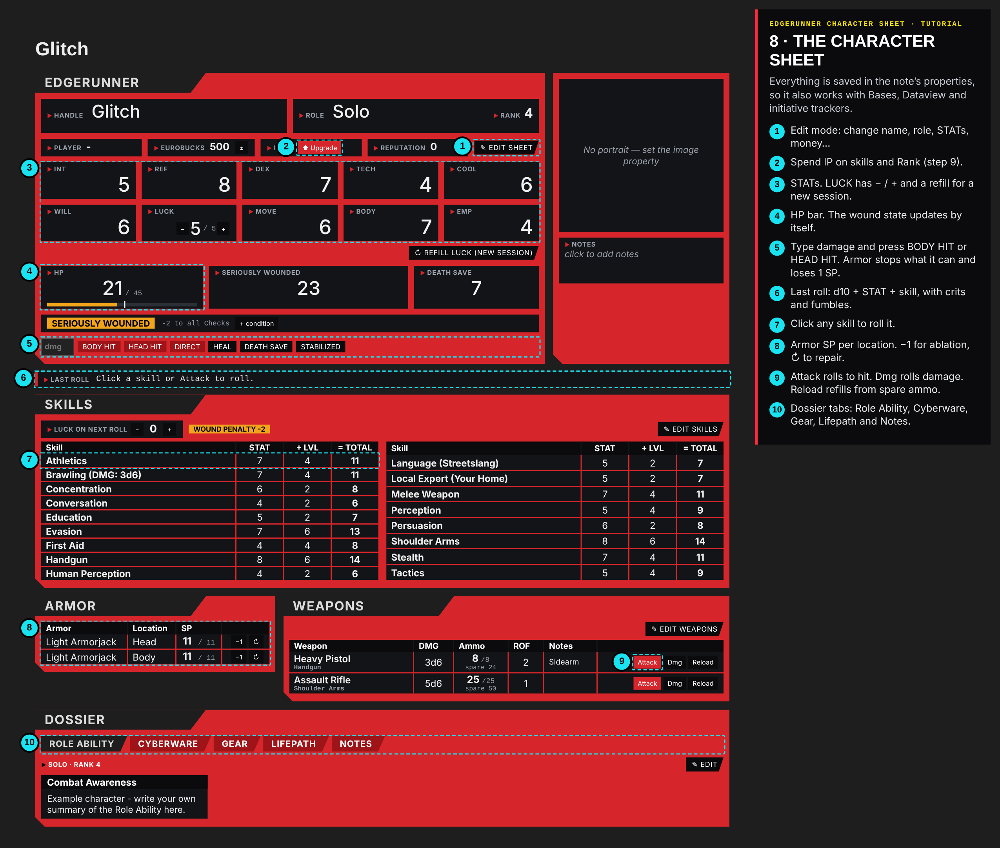
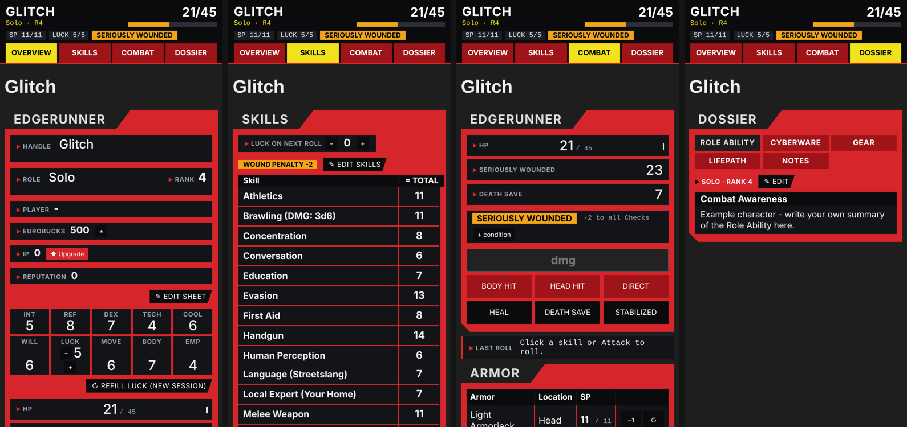

# Edgerunner Character Sheet
### An unofficial character sheet and card kit for the Cyberpunk RED tabletop RPG in Obsidian

> **Edgerunner Character Sheet is unofficial content provided under the [Homebrew Content Policy of R. Talsorian Games](https://rtalsoriangames.com/homebrew-content-policy/) and is not approved or endorsed by RTG. This content references materials that are the property of R. Talsorian Games and its licensees.**
>
> This repository has no rulebook text, stat blocks, pregenerated characters or art. You need the Cyberpunk RED Core Rulebook to play.



**New here? Read the [illustrated tutorial](TUTORIAL.md).**



## What's inside

| Part | What it does |
|---|---|
| **Character sheet plugin** (`cpr-character-sheet`) | STATs, skills with d10 rolls (crit/fumble), HP with Seriously or Mortally Wounded penalties, Death Save, armor ablation, weapons and ammo, cyberware, gear, lifepath, a roll log, a **character creation wizard**, **IP upgrades**, **homebrew** item, enemy, NPC, role and skill forms, and a **phone layout**. All data lives in the note's properties. |
| **CSS snippet** `cyberpunk-red-cards.css` | Styles the NPC and enemy statblocks, the item cards and the home page. |
| **Item card script** `cpr-item-card/view.js` | Dataview script that draws a card from an item note's properties. |
| **Fantasy Statblocks layout** `CPR Character` | Layout for NPCs and enemies. |
| **Templater templates** | `CPR NPC` and `CPR Item`. |
| **Home page** `Úvod.md` | A Bases dashboard with crew cards (HP, SP, conditions), NPCs, enemies, items and conditions, plus Meta Bind buttons. |
| **Example vault** | A ready folder structure with *original* example content: one character, enemy, NPC, item and condition. |

## Required community plugins

- **Dataview** (turn on *Enable JavaScript Queries*)
- **Templater**
- **Fantasy Statblocks**
- **Meta Bind** (home page buttons)
- **Initiative Tracker / Roll for Initiative**: optional. The note properties (`hp`, `hp_current`, `ref`, `sp_head`, `sp_body`, `conditions`, `type`) are compatible with it.
- **Homepage**: optional, to open `Úvod.md` on start.
- **Bases**: core plugin, needs Obsidian 1.9 or newer.

## Quick start (the easiest way)

1. Copy the whole `example-vault` folder somewhere and open it in Obsidian as a vault. Its `.obsidian` folder is hidden on most systems, so copy it too.
   Then put `main.js`, `manifest.json` and `styles.css` (from the latest **Release**, or the repository root) into `example-vault/.obsidian/plugins/cpr-character-sheet/`.
2. Turn off Restricted mode and install the plugins listed above.
3. **Settings → Community plugins** → enable **Edgerunner Character Sheet**.
4. **Settings → Appearance → CSS snippets** → enable `cyberpunk-red-cards`.
5. **Fantasy Statblocks → Layouts → Import From JSON** → `config/fantasy-statblocks-layout-CPR-Character.json`. Keep the name `CPR Character`.
6. **Templater** → *Template folder location* = `0. Kompendium/_templates`.
7. **Meta Bind** → *Button templates*: add the four buttons from `config/meta-bind-buttons.json`. Alternatively, close Obsidian and paste the `buttonTemplates` array into `.obsidian/plugins/obsidian-meta-bind-plugin/data.json`.
8. Optional: in Roll for Initiative use the folders from `config/roll-for-initiative-settings.json`.

## Adding it to an existing vault

- Plugin: download `main.js`, `manifest.json` and `styles.css` from the latest **Release** into `<vault>/.obsidian/plugins/cpr-character-sheet/`.
  Alternatively, install it with the **BRAT** plugin: *Add beta plugin* → paste this repository's URL.
- Snippet: copy `example-vault/.obsidian/snippets/cyberpunk-red-cards.css` to `<vault>/.obsidian/snippets/`.
- Script: copy `example-vault/0. Kompendium/_scripts/cpr-item-card/` anywhere in the vault. Dataview finds it by the path ending `_scripts/cpr-item-card`.
- In **Settings → Edgerunner Character Sheet**, set your folders for characters, enemies, NPCs and items.

### Default folder structure

```
0. Kompendium/_scripts, _templates
1. Pravidla/Stavy        conditions
2. Hráči                 player characters
3. Nepřátelé             enemies (type: monster)
4. Předměty              items (homebrew items are sorted into subfolders)
5. NPC                   friendly NPCs (type: npc)
Úvod.md                  home page
```

## Releasing a new version

1. Raise `version` in `manifest.json` and add it to `versions.json`.
2. Commit, then push a tag with the same number, e.g. `git tag 1.0.1 && git push origin 1.0.1`.
3. The GitHub Action creates the release with `main.js`, `manifest.json` and `styles.css`, plus a build attestation.

## Using the sheet

- **New character**: the ribbon icon on the left, the *+ Přidat Hráče* button on the home page, or the command *New character (wizard)*. Pick a Role and a method (Streetrat, Edgerunner or Complete Package), roll the Lifepath, STATs, skills, gear and cyberware, then review.
- **Edit sheet** turns on editing. Values can also be changed in the note properties.
- **Damage**: type the damage and press BODY HIT or HEAD HIT. Armor stops what it can and loses 1 SP. Wound penalties apply automatically.
- **Upgrade** (next to IP): spend Improvement Points on skills and Rank.
- **Homebrew** (commands, or the home page buttons): create items, enemies, NPCs, new Roles and new Skills.
- **Phone**: a sticky top bar with HP, SP, LUCK and wound state, plus four pages: Overview, Skills, Combat and Dossier.

## Your own content

Your item, condition and enemy notes come from your own book. The policy above doesn't let fans republish stat blocks or rules text, so don't commit those notes to a public fork. The `.gitignore` here ignores the content folders by default except for the examples.

## Privacy & permissions

- **No network access.** The plugin makes no internet requests. The optional CSS snippet loads three free fonts from Google Fonts, and works without them.
- **Vault access.** The plugin lists the files in your vault (`getFiles`, `getMarkdownFiles`) for these purposes:
  - showing the portrait picker
  - showing your item notes in the wizard shop and homebrew forms
  - finding your characters
- **Writes.** It only writes to the character note you are using, and to notes you create with its wizard or forms.
- **Settings and data.** Settings are stored in the plugin's own `data.json`. Character data is stored in the note's properties.

## License

Code (`main.js`, `styles.css`, `view.js`, CSS snippet, templates) is released under the MIT License, see `LICENSE`. The license covers only the original code in this repository.
Cyberpunk and Cyberpunk RED are trademarks of CD PROJEKT S.A. and R. Talsorian Games. This license covers none of their material.
