# Tutorial

A short tour of **Edgerunner Character Sheet**. The numbers in each picture match the hints next to it.

## Creating a character

Open the wizard with the ribbon icon on the left bar, the **+ Přidat Hráče** button on the home page, or the command **Edgerunner Character Sheet: New character (wizard)**.

### 1 · Role and method
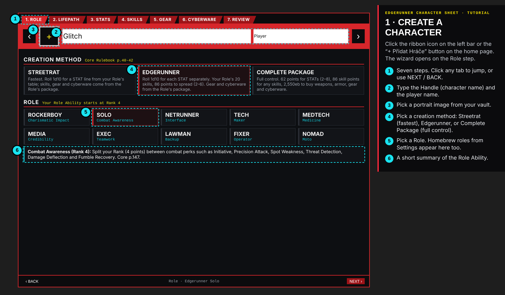

### 2 · Lifepath
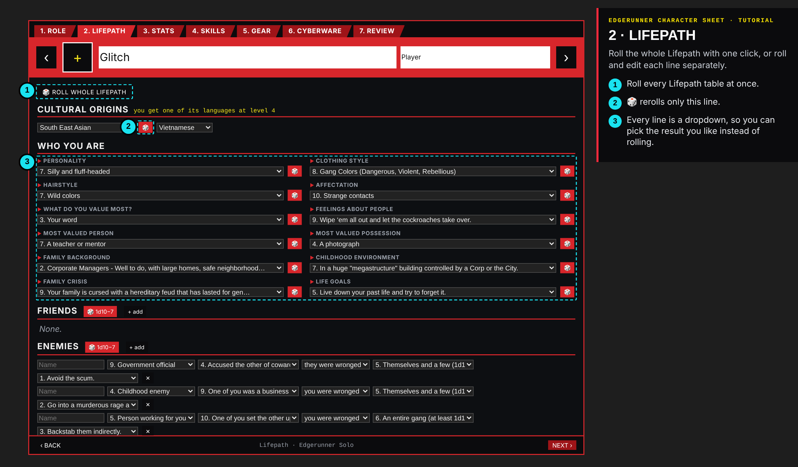

### 3 · STATs
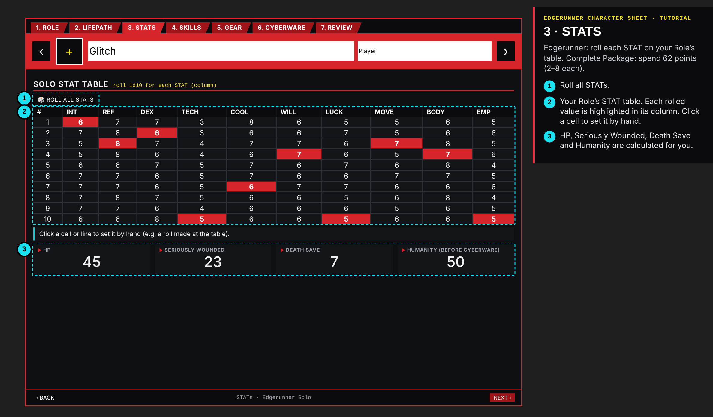

### 4 · Skills
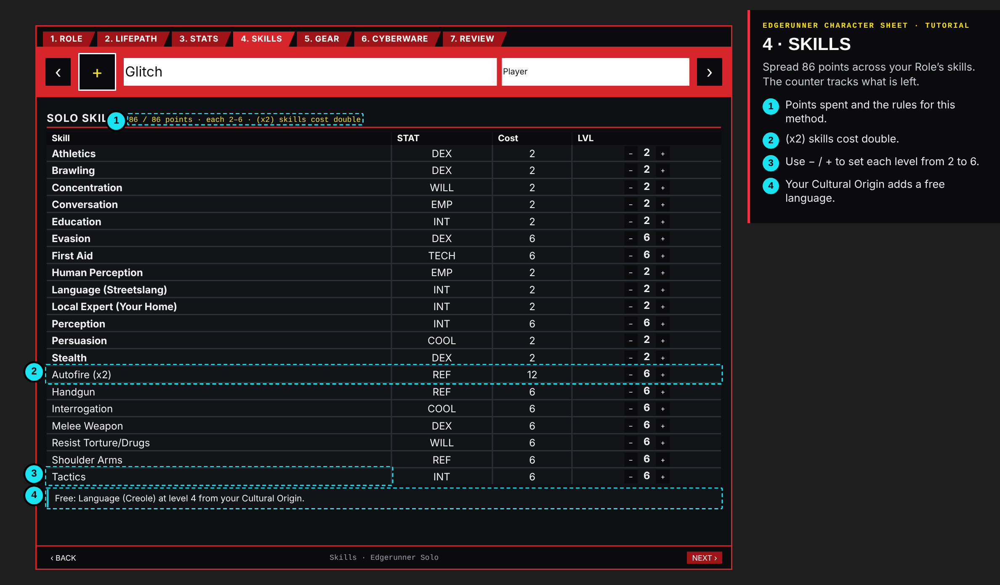

### 5 · Gear and 6 · Cyberware
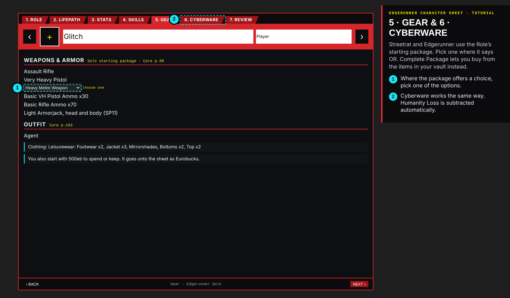

### 7 · Review and create
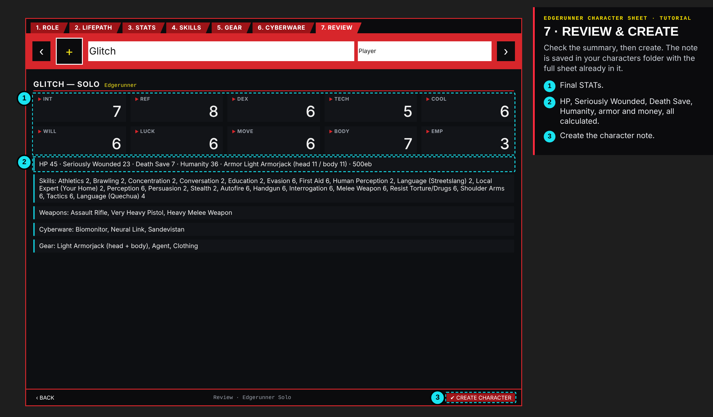

## Playing

### 8 · The character sheet
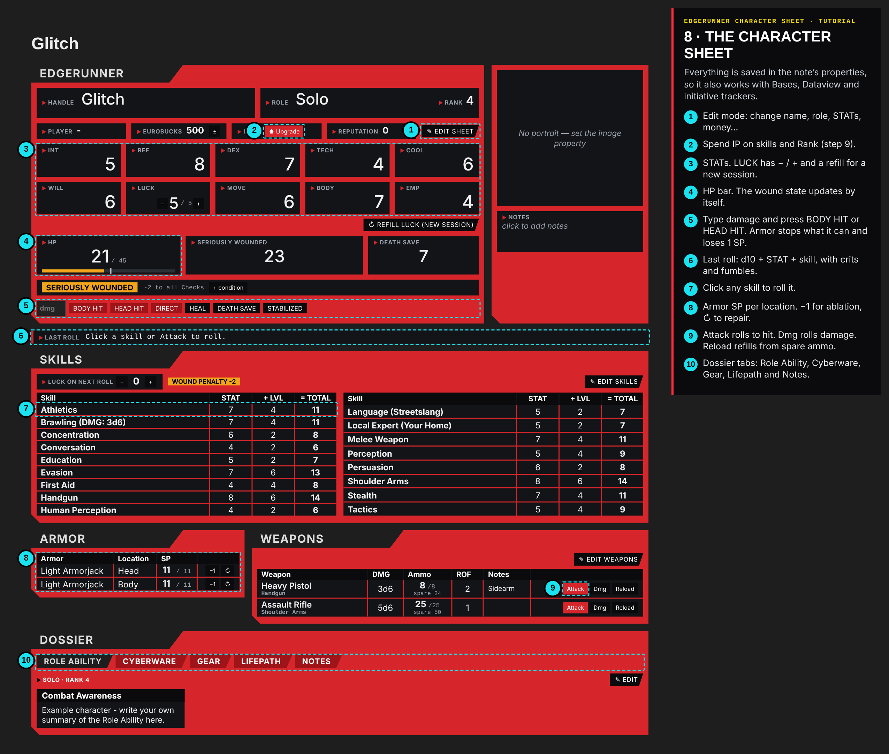

**In combat:** type the damage into **dmg** and press **BODY HIT** or **HEAD HIT**. The sheet subtracts the armor's SP, lowers the SP by 1, updates HP and sets **Seriously Wounded** or **Mortally Wounded** with the right penalty. **DIRECT** ignores armor. **HEAL** adds HP.

### 9 · Upgrade with IP
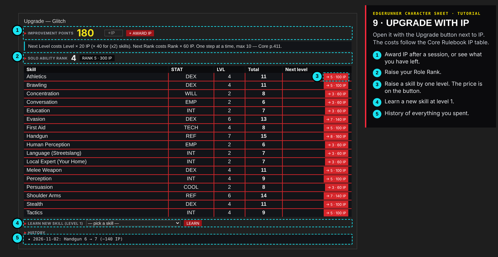

## Running the game (GM)

### 10 · Homebrew items
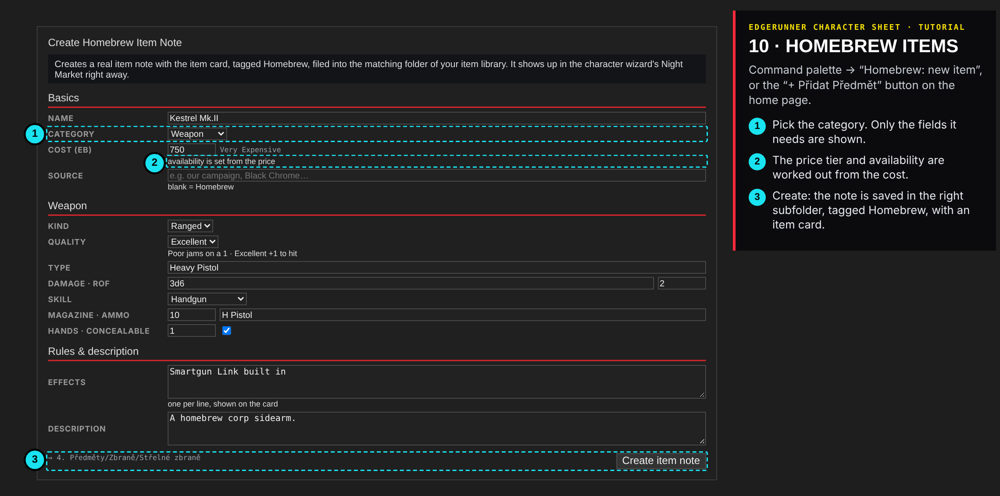

### 11 · Homebrew enemies and NPCs
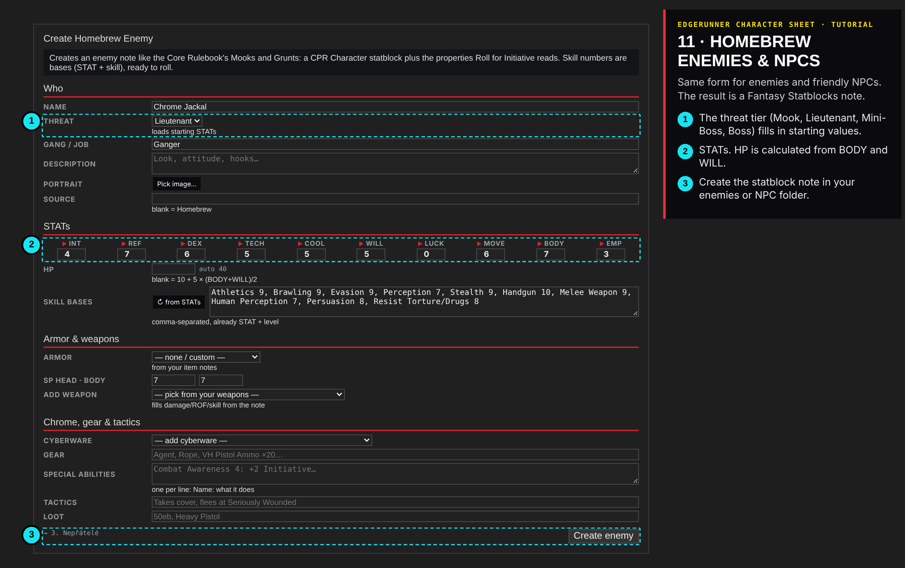

New **Roles** and **Skills** are added in **Settings → Edgerunner Character Sheet → Homebrew**. They then show up in the wizard and the Upgrade window.

## 12 · On your phone
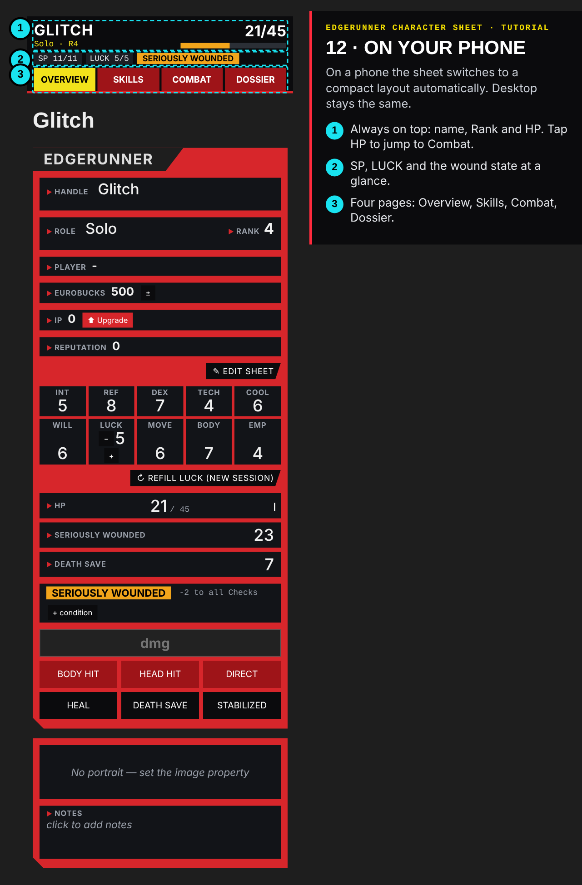

The phone layout switches on by itself on a phone, or in any pane narrower than 600px. Desktop stays the same.
